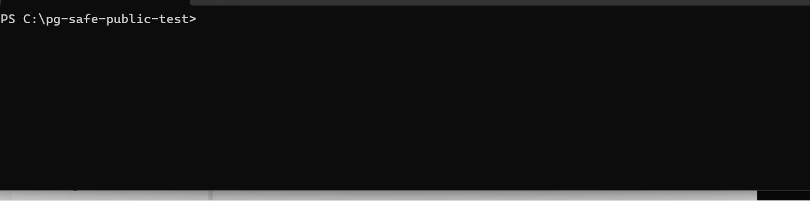

> **Development notice:** This checkout is a v2.0.0-rc.1 candidate, not the published v1.1.2. See [UPGRADE-NOTES.md](UPGRADE-NOTES.md) for implemented features and unverified limitations.

# pg-safe-migrate

**Catch risky PostgreSQL migrations before they reach production.**

An open-source, AST-based PostgreSQL migration risk linter for **Prisma, Drizzle, and raw SQL**.

Detect six common migration patterns that may cause blocking database locks or application compatibility problems.

**Features:** PostgreSQL AST parsing · 6 safety rules · Git-diff mode · GitHub Actions · Zero-config migration detection

> **Important:** This tool identifies configured migration risks. It does not guarantee zero downtime.

## Demo

See how `pg-safe-migrate` catches an unsafe PostgreSQL migration and suggests a safer alternative.



### Example

Unsafe migration:

```sql
CREATE INDEX idx_users_email ON users(email);
```

Detected issue:

```text
[PG001] CREATE INDEX on "users" acquires a SHARE lock and blocks writes.

Fix: Use CREATE INDEX CONCURRENTLY and execute outside a transaction block.

Found 1 blocking migration issue(s).
```

Safer alternative:

```sql
CREATE INDEX CONCURRENTLY idx_users_email ON users(email);
```

`CREATE INDEX CONCURRENTLY` must run outside a transaction block.

## Installation

Install as a development dependency:

```bash
npm install --save-dev @subodh001/pg-safe-migrate
```

Or execute the published package without installing it in your project:

```bash
npx --yes --package=@subodh001/pg-safe-migrate@1.1.2 pg-safe-migrate --help
```

## Quick start

### Automatically detect migrations

```bash
npx pg-safe-migrate
```

The CLI searches these directories:

- `prisma/migrations`
- `drizzle`
- `migrations`
- `db/migrations`

### Prisma

```bash
npx pg-safe-migrate prisma/migrations
```

### Drizzle

```bash
npx pg-safe-migrate drizzle
```

### Raw SQL

```bash
npx pg-safe-migrate db/migrations
```

### Check a specific migration

```bash
npx pg-safe-migrate path/to/migration.sql
```

### Check changed migrations only

```bash
npx pg-safe-migrate --changed origin/main
```

Without a base reference, `--changed` checks staged, unstaged, and untracked SQL files. With a base reference, it additionally checks branch changes.

For pull requests, fetch the base branch first. Use `fetch-depth: 0` in GitHub Actions.

## PostgreSQL migration rules

| Rule | Detected pattern | Potential risk |
|---|---|---|
| **PG001** | CREATE INDEX without CONCURRENTLY | Blocks writes during index creation |
| **PG002** | DROP COLUMN | Breaks older application versions |
| **PG003** | ALTER COLUMN TYPE | Strong locks and possible table rewrites |
| **PG004** | ADD COLUMN NOT NULL without DEFAULT | Backfill and compatibility risks |
| **PG005** | ADD FOREIGN KEY without NOT VALID | Validation may block writes |
| **PG006** | RENAME | Breaks applications expecting old names |

Each finding includes a description of the risk and a suggested safer migration approach.

A passing result means no configured patterns were detected, not that a migration is guaranteed to be safe.

## GitHub Actions integration

Automatically check migration files during pull requests.

Copy the [example consumer workflow](https://github.com/subodhsingh001/pg-safe-migrate/blob/main/examples/consumer-workflow.yml) into your application's repository:

```text
.github/workflows/pg-safe-migrate.yml
```

The workflow checks changed SQL migrations so teams can adopt the linter without immediately rewriting historical migrations.

For reproducible builds, pin the package to a reviewed version and upgrade deliberately.

## Verify the published CLI

From a clean directory, run:

```bash
npx --yes --package=@subodh001/pg-safe-migrate@1.1.2 pg-safe-migrate --help
```

Create a file named `unsafe.sql`:

```sql
CREATE INDEX idx_users_email ON users(email);
```

Then execute:

```bash
npx --yes --package=@subodh001/pg-safe-migrate@1.1.2 pg-safe-migrate unsafe.sql
```

Expected behavior: PG001 is reported and the CLI exits with code `1`.

The included `examples/safe.sql` demonstrates concurrent index creation and should pass PG001.

## Development

Clone the repository:

```bash
git clone https://github.com/subodhsingh001/pg-safe-migrate.git
cd pg-safe-migrate
```

Install dependencies:

```bash
npm ci
```

Run tests:

```bash
npm test
```

Test the rule engine:

```bash
node bin/cli.js test/unsafe_migration.sql
```

Check the npm package:

```bash
npm pack --dry-run
```

## Current release

**v1.1.2**

- Six PostgreSQL migration risk rules
- PostgreSQL AST-based parsing
- Prisma and Drizzle migration directory detection
- Git-diff mode
- GitHub Actions support
- Actionable migration recommendations

[View npm package](https://www.npmjs.com/package/@subodh001/pg-safe-migrate) · [View GitHub releases](https://github.com/subodhsingh001/pg-safe-migrate/releases) · [Report an issue](https://github.com/subodhsingh001/pg-safe-migrate/issues)

## Limitations

`pg-safe-migrate` is a static AST-based linter, not a migration execution simulator.

It does not:

- Connect to your production database
- Estimate actual lock waiting times
- Validate rollback procedures
- Inspect live database schemas
- Guarantee zero downtime
- Analyze SQL embedded inside changed JavaScript or TypeScript files

Some flagged operations may be acceptable under controlled conditions. Some unflagged operations may still cause downtime.

Always consider PostgreSQL version, table size, transaction behavior, lock timeouts, long-running transactions, and application deployment sequencing.

## Contributing

Contributions, bug reports, PostgreSQL edge cases, and suggestions for additional safety rules are welcome.

Open an issue or submit a pull request on GitHub.

## License

MIT License.

## v2.0 release candidate features

> Development candidate: do not publish until the full test suite and representative PostgreSQL integration tests pass.

- `--postgres-version 10` enables PostgreSQL-10-specific default-column rewrite warnings; version 11+ does not trigger that rule. This is a targeted version check, not complete PostgreSQL-version simulation.
- `--advisor` gives Prisma/Drizzle/raw-SQL-aware deployment guidance. Recommendations are advisory and do not inspect the live database.
- Cross-file analysis checks files in lexicographic order and warns on selected operations involving tables changed earlier. This is a heuristic, not a dependency graph.
- Transaction analysis uses parsed SQL statements, avoiding comment/string false positives from keyword matching. It cannot know whether an external ORM runner wraps a migration in a transaction.
- JSON and SARIF outputs include source locations when the PostgreSQL parser supplies statement offsets.
- `examples/consumer-workflow.yml` illustrates GitHub code-scanning SARIF upload and policy enforcement. GitHub code-scanning availability and permissions depend on repository settings and plan.

### Examples

```bash
node bin/cli.js prisma/migrations --postgres-version 16 --advisor
node bin/cli.js db/migrations --format json --output report.json
node bin/cli.js --changed origin/main --format sarif --output report.sarif --fail-on none
```

### Known gaps

The analyzer does not connect to PostgreSQL, determine real table sizes, model application compatibility, or prove migrations are safe. Prisma and Drizzle transaction behavior depends on the actual runner and configuration. SARIF code-scanning upload is optional and needs GitHub security permissions.
